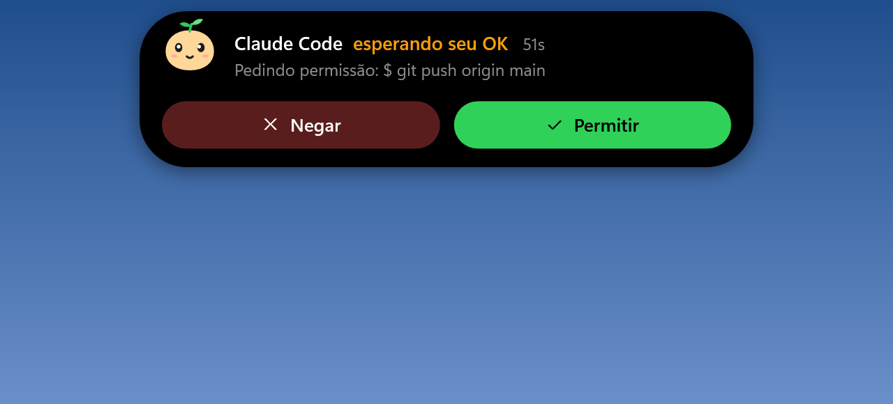
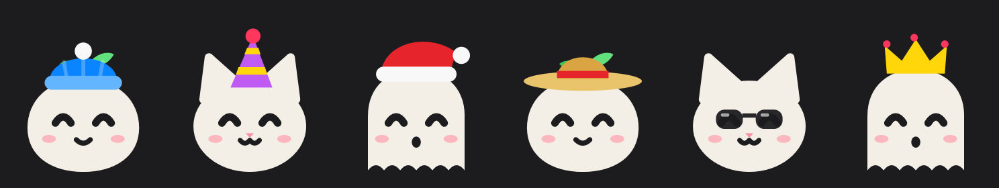
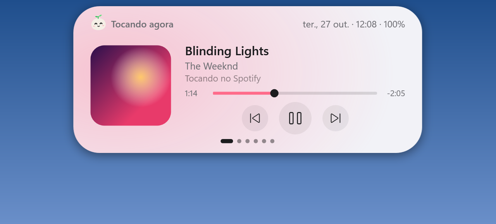
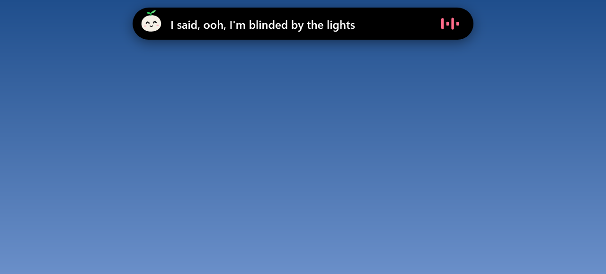
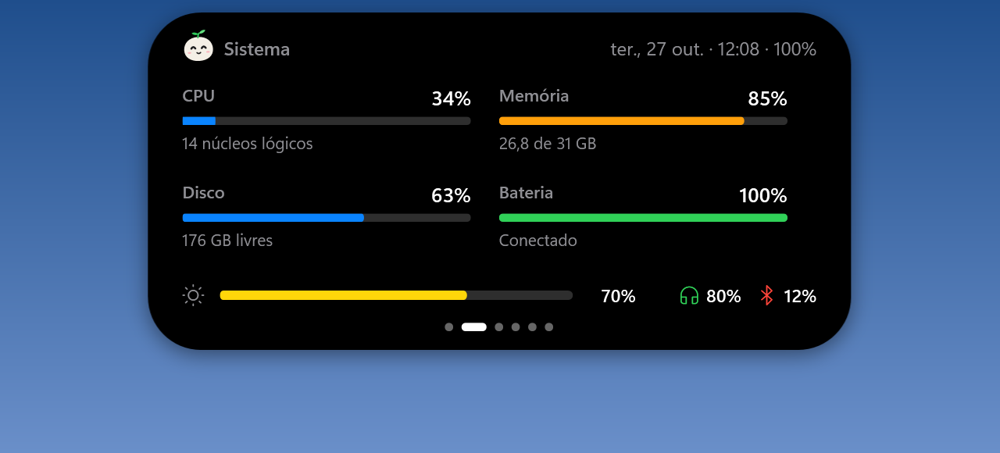
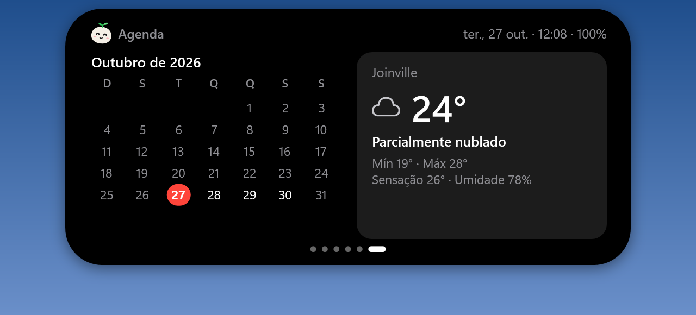
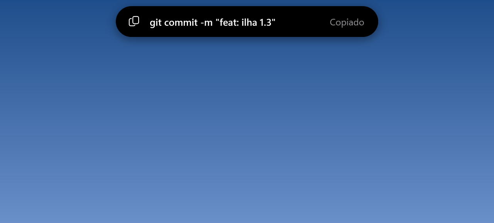
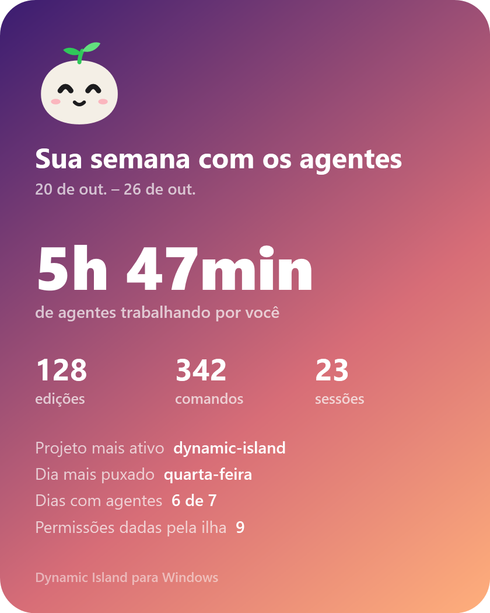

<p align="center"></p>

# Dynamic Island para Windows

Uma ilha dinâmica no topo da tela, no estilo do iPhone, feita em C# / WPF (.NET 10).
Mostra música, volume, bateria, sistema, timer, notificações, microfone/câmera em uso, uma bandeja
de arquivos e o que seus agentes de IA (Copilot no VS Code, Claude Code) estão fazendo — sem
atrapalhar: os cliques passam por ela.

<p align="center">
  
</p>

## Baixar

1. Baixe **[DynamicIsland.exe](https://github.com/theuslpszbr15/dynamic-island-windows/releases/latest/download/DynamicIsland.exe)**
   (não precisa instalar o .NET).
2. Abra. Se o Windows mostrar "O Windows protegeu o computador", clique em *Mais informações → Executar assim mesmo*
   (o executável não é assinado).
3. No ícone da bandeja, clique em **Instalar no computador**: ela vai para
   `%LOCALAPPDATA%\Programs\DynamicIsland`, ganha atalho no menu Iniciar, inicia com o Windows e aparece em
   *Configurações → Aplicativos* para desinstalar. Não pede administrador.

## O que ela faz

| | |
|---|---|
| **Mascotes** — o **Coco** (o mascote da ilha: um coquinho com brotinho), a **Pipoca** (gatinha) ou o **Bu** (fantasminha). Seguem o mouse com os olhos, dançam com a música, ficam azuis enquanto o agente trabalha, laranja e pulando quando ele precisa de você, comemoram quando termina e dormem quando nada acontece. Clique: ficam bravos; três vezes rápido, ficam tontos. |   |
| **Permitir / Negar** — quando o Claude Code pede permissão (rodar um comando, editar um arquivo), a pergunta aparece na ilha com dois botões. Sem resposta em ~55 s, ele pergunta no terminal como sempre. |  |
| **Roupinhas** — gorro, chapéu de festa, gorro de Natal, chapéu de palha, óculos escuros e coroa. No modo automático o mascote se veste sozinho no Natal, nas festas juninas e no Ano-Novo. O mascote também pode morar na **área de trabalho**: arraste para onde quiser; ele corre até a ilha quando um agente chama. |  |
| **Agentes ao vivo** — o mascote do agente, os passos (Leitura, Edição, Terminal…) e o diff da última edição; com vários agentes, a lista de todos com o mascote de cada um. |  |
| **Vidro (desfocado)** — "liquid glass" estilo iOS 26: o fundo atrás da ilha é fosco no meio e se curva como uma lente nas bordas, com brilho na borda, além de 8 cores sólidas (Obsidiana, Grafite, Ardósia, Oceano, Floresta, Café, Ameixa, Cereja) e o tema claro **Porcelana**. |   |
| **Mídia** — capa, título, progresso e controles de qualquer player (Spotify, YouTube…). A cor de destaque vem da capa. Com mais de um app tocando, bolinhas sobre a capa escolhem qual controlar. |  |
| **Letra sincronizada** — a linha que está sendo cantada aparece na ilha (letras do [LRCLIB](https://lrclib.net), guardadas no PC). Precisa de um player que informe a posição da música, como o app do Spotify. |  |
| **Volume** — barra ao mudar o volume (role o mouse sobre ela para ajustar). |  |
| **Agentes de IA** — azul trabalhando, laranja precisa de você, verde concluído. |  |
| **Sistema** — CPU, memória, disco, bateria, **brilho da tela** (arraste a barra) e bateria dos fones/mouses **Bluetooth** (avisa quando está acabando). |  |
| **Agenda** — calendário do mês e o clima de agora na sua cidade (wttr.in). |  |
| **Copiou, apareceu** — texto, imagem ou arquivos copiados aparecem por um instante; também Caps Lock e Num Lock. Gerenciadores de senha que pedem sigilo são ignorados. |  |
| **Resumo da semana** — toda segunda-feira: quanto tempo os agentes trabalharam, edições, comandos, projeto mais ativo. Dá para salvar como imagem. Os números ficam só no seu PC. |  |
| **Bandeja de arquivos** — arraste arquivos até a ilha, arraste de volta quando precisar. |  |
| **Timer / Pomodoro** — 5, 15, 25, 45 min ou 1 h; a contagem fica na ilha e ela toca um alarme no fim. |  |
| **Notificações do Windows** — WhatsApp, Teams, Slack, e-mail… aparecem na ilha com o ícone do app. |  |
| **Microfone e câmera** — avisa qual app começou a usar e deixa um ponto laranja (mic) ou verde (câmera) ao lado. |  |
| **Formato notch** — colado na borda, com cantos invertidos. |  |

- **Discreta:** quando ociosa vira uma barrinha fina no topo; a janela é *click-through*, então abas do navegador continuam clicáveis.
- **Abre** parando o mouse sobre ela; a roda do mouse troca de página.
- **Vários monitores:** fica na tela principal, numa tela escolhida ou segue a janela ativa (respeita a escala de cada monitor).
- Some sozinha com app em tela cheia e não rouba o foco.
- **Atalhos:** `Ctrl+Alt+D` esconde/mostra a ilha, `Ctrl+Alt+M` mídia, `Ctrl+Alt+T` timer, `Ctrl+Alt+A` agentes, `Ctrl+Alt+C` agenda.
- **Atualizações:** avisa quando sai uma versão nova aqui no GitHub e se atualiza com um clique (o arquivo é conferido pelo SHA-256 da release).

## Configurações

No ícone da bandeja (ou clique direito na ilha): formato pílula/notch, tema, mascote, roupinha, mascote na área de
trabalho, recolher quando ociosa, monitor, o que mostrar na ilha (notificações, letras, área de transferência, Caps Lock),
resumo da semana, iniciar com o Windows, conectar Copilot, hooks do Claude Code, atualizações e instalar/desinstalar.

> No tema **Vidro** a ilha não aparece em prints nem em compartilhamento de tela: ela se esconde da captura
> para conseguir desfocar o que está atrás dela.

## Compilar

Requer Windows 10 (2004+) ou 11 e o .NET 10 SDK.

```powershell
dotnet build
.\bin\Debug\net10.0-windows10.0.22621.0\DynamicIsland.exe

# executável único (o mesmo da página de Releases)
dotnet publish -c Release -r win-x64 --self-contained -p:PublishSingleFile=true `
  -p:IncludeNativeLibrariesForSelfExtract=true -p:EnableCompressionInSingleFile=true -p:DebugType=none -o publish
```

`DynamicIsland.exe --install` instala sem perguntar; `--uninstall` remove (é o que *Configurações → Aplicativos* chama).

## Agentes de IA

- **Copilot (VS Code / CLI):** menu da bandeja → *Conectar Copilot (VS Code)*. Cria
  `~/.copilot/hooks/dynamic-island.json`; vale para chats novos.
- **Claude Code:** menu da bandeja → *Copiar hooks do Claude Code* e cole em `~/.claude/settings.json`
  (inclui o hook `PermissionRequest`, que leva os pedidos de permissão para a ilha).
- **Qualquer script:**

  ```powershell
  DynamicIsland.exe agent --name "Build" --state working --text "dotnet build"
  # estados: working | waiting | done | idle | end
  ```

Os eventos chegam por um *named pipe* restrito ao usuário atual. O comando sempre sai com código 0 e só escreve
no stdout para responder a um pedido de permissão que você aceitou ou negou na ilha.

Conexões de rede (todas opcionais): letras no `lrclib.net`, clima no `wttr.in` e a checagem de versão na API do GitHub.

## Desenvolvimento

`DynamicIsland.exe --snapshot <pasta>` renderiza todos os estados da ilha em PNG com dados de
demonstração (foi assim que as imagens acima foram geradas).

| Arquivo | Conteúdo |
|---|---|
| `IslandWindow.xaml(.cs)` | Interface, animação de mola, estados e páginas |
| `IslandWindow.Activities.cs` | Timer, notificações e indicador de microfone/câmera |
| `IslandWindow.Extras.cs` | Permissões, pílula de info (área de transferência, Caps Lock), atalhos, letras, players, brilho, Bluetooth, agenda |
| `DesktopPetWindow.cs`, `RecapWindow.cs` | Mascote na área de trabalho e resumo da semana |
| `Services/Updater.cs`, `LyricsService.cs`, `WeatherService.cs` | Atualização pelo GitHub, letras (LRCLIB) e clima (wttr.in) |
| `Services/Brightness.cs`, `BluetoothBattery.cs`, `AgentStats.cs` | Brilho (DDC/CI e WMI), bateria Bluetooth e estatísticas locais |
| `PetView.cs`, `IslandWindow.Pet.cs` | Mascotes (desenhados com formas WPF, humores e reações), temas, vidro e detalhe do agente |
| `Services/NotificationService.cs` | Notificações do Windows (UserNotificationListener) |
| `Services/PrivacyMonitor.cs` | Apps usando microfone/câmera (mesmos dados do indicador do Windows) |
| `Services/Installer.cs` | Instalação por usuário, atalho e entrada em Aplicativos |
| `Services/MediaService.cs` | Sessão de mídia do Windows (GSMTC) |
| `Services/VolumeService.cs` | Volume via Core Audio |
| `Services/BatteryService.cs` | Eventos de energia |
| `Services/AgentHub.cs`, `AgentCli.cs` | Pipe dos agentes e CLI dos hooks |
