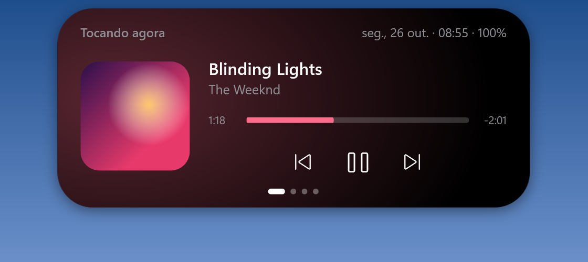
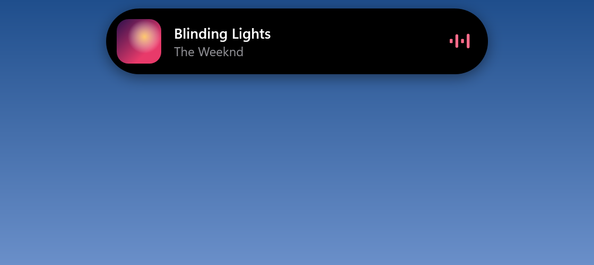
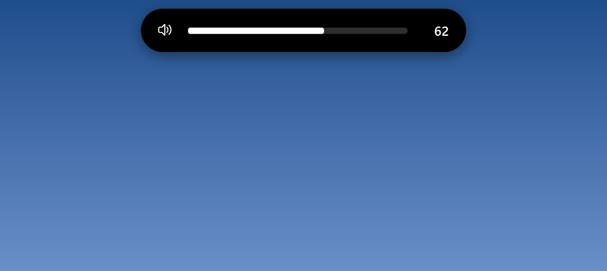
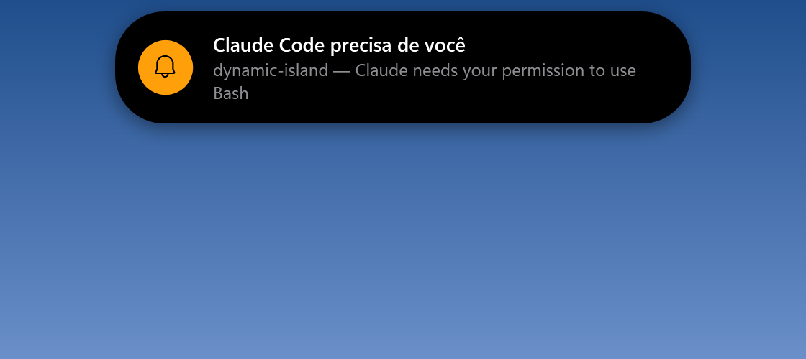
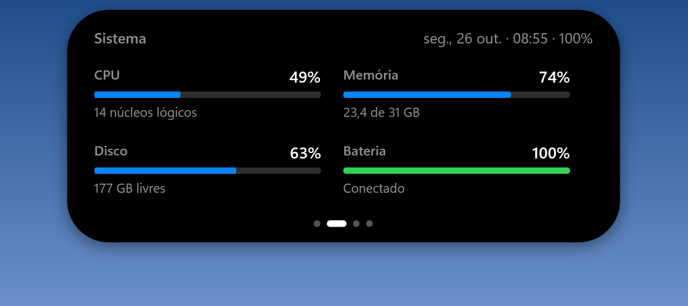
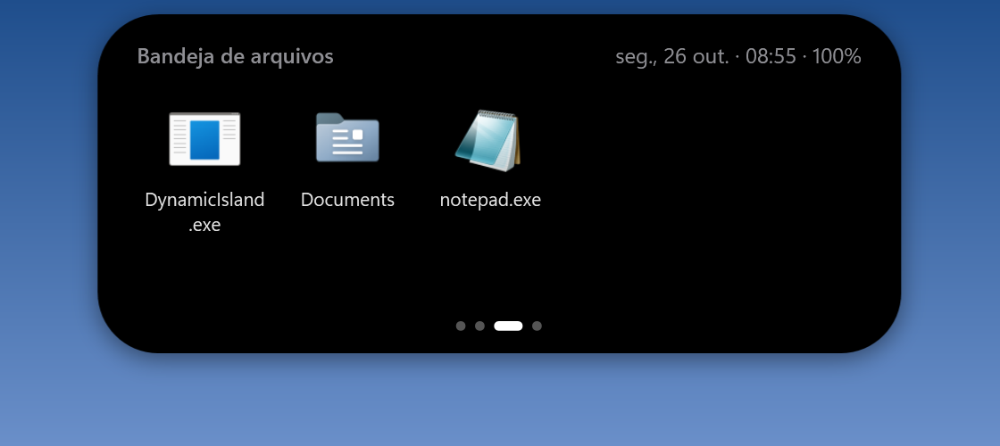
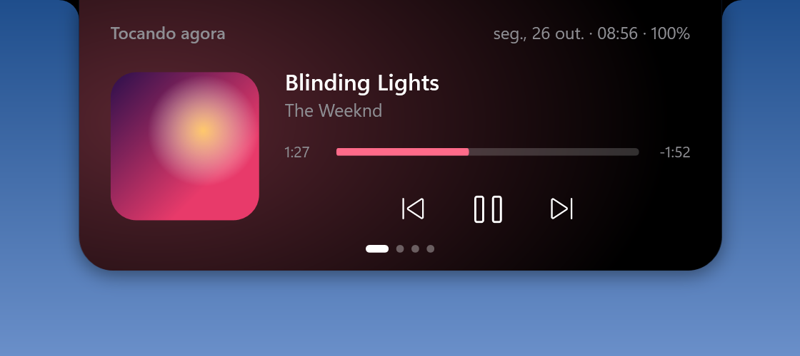

# Dynamic Island para Windows

Uma ilha dinâmica no topo da tela, no estilo do iPhone, feita em C# / WPF (.NET 10).
Mostra música, volume, bateria, sistema, uma bandeja de arquivos e o que seus agentes de IA
(Copilot no VS Code, Claude Code) estão fazendo — sem atrapalhar: os cliques passam por ela.

<p align="center">
  
</p>

## O que ela faz

| | |
|---|---|
| **Mídia** — capa, título, progresso e controles de qualquer player (Spotify, YouTube…). A cor de destaque vem da capa. |  |
| **Volume** — barra ao mudar o volume (role o mouse sobre ela para ajustar). |  |
| **Agentes de IA** — azul trabalhando, laranja precisa de você, verde concluído. |  |
| **Sistema** — CPU, memória, disco e bateria. |  |
| **Bandeja de arquivos** — arraste arquivos até a ilha, arraste de volta quando precisar. |  |
| **Formato notch** — colado na borda, com cantos invertidos. |  |

- **Discreta:** quando ociosa vira uma barrinha fina no topo; a janela é *click-through*, então abas do navegador continuam clicáveis.
- **Abre** parando o mouse sobre ela; a roda do mouse troca de página.
- Some sozinha com app em tela cheia e não rouba o foco.

## Rodar

Requer Windows 10 (2004+) ou 11 e o .NET 10 SDK.

```powershell
dotnet build
.\bin\Debug\net10.0-windows10.0.22621.0\DynamicIsland.exe
```

Configurações ficam no ícone da bandeja (ou clique direito na ilha expandida): formato pílula/notch,
recolher quando ociosa, iniciar com o Windows, conectar Copilot e hooks do Claude Code.

## Agentes de IA

- **Copilot (VS Code / CLI):** menu da bandeja → *Conectar Copilot (VS Code)*. Cria
  `~/.copilot/hooks/dynamic-island.json`; vale para chats novos.
- **Claude Code:** menu da bandeja → *Copiar hooks do Claude Code* e cole em `~/.claude/settings.json`.
- **Qualquer script:**

  ```powershell
  DynamicIsland.exe agent --name "Build" --state working --text "dotnet build"
  # estados: working | waiting | done | idle | end
  ```

Os eventos chegam por um *named pipe* restrito ao usuário atual. O comando nunca escreve no stdout e
sempre sai com código 0, então não trava nem altera o agente.

## Desenvolvimento

`DynamicIsland.exe --snapshot <pasta>` renderiza todos os estados da ilha em PNG com dados de
demonstração (foi assim que as imagens acima foram geradas).

| Arquivo | Conteúdo |
|---|---|
| `IslandWindow.xaml(.cs)` | Interface, animação de mola, estados e páginas |
| `Services/MediaService.cs` | Sessão de mídia do Windows (GSMTC) |
| `Services/VolumeService.cs` | Volume via Core Audio |
| `Services/BatteryService.cs` | Eventos de energia |
| `Services/AgentHub.cs`, `AgentCli.cs` | Pipe dos agentes e CLI dos hooks |
