<p align="center">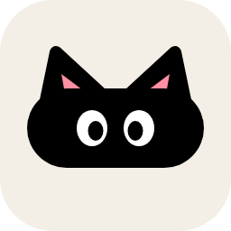</p>

# Dynamic Island para Windows

Uma ilha dinâmica no topo da tela, no estilo do iPhone, feita em C# / WPF (.NET 10).
Mostra música, volume, bateria, sistema, timer, notificações, microfone/câmera em uso, uma bandeja
de arquivos e o que seus agentes de IA (Copilot no VS Code, Claude Code) estão fazendo — sem
atrapalhar: os cliques passam por ela.

<p align="center">
  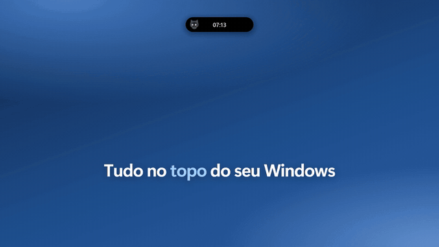
</p>

## Tudo o que ela faz

Grátis, código aberto (MIT), em português, sem conta e sem anúncio. Um executável, instala sem administrador e se
atualiza sozinha (conferindo o SHA-256 de cada versão).

**Na ilha do PC**
- **Música:** capa, controles e progresso de qualquer player (Spotify, YouTube, apps do Windows), cor tirada da capa,
  **letra sincronizada** na ilha e em tela cheia (modo karaokê), vários players ao mesmo tempo.
- **Sistema:** volume (role o mouse para ajustar), brilho do monitor (DDC/CI), CPU, memória, disco, bateria do notebook
  e dos fones/mouses **Bluetooth**, queda e volta da **internet**, **progresso dos downloads** do navegador.
- **Avisos:** notificações do Windows com o ícone do app (WhatsApp, Teams, e-mail…), **microfone e câmera em uso** e por
  qual app, quem entra e sai da **call do Discord** com foto, Caps Lock e Num Lock, e o que você copiou.
- **Produtividade:** timer e Pomodoro com **modo foco** (segura as notificações), tarefas com prazo, lembrete de água,
  nota rápida, textos de 1 clique (PIX, e-mail), **agenda** do mês com clima e **"reunião em 5 min"** com botão Entrar
  (Google Agenda, Outlook, Teams, Meet, Zoom, Webex), bandeja de arquivos para arrastar e soltar.
- **Histórico do que você copiou** (os últimos 20, com fixar e busca; os fixados ficam cifrados no disco).
- **OCR:** `Ctrl+Alt+O`, arraste sobre qualquer parte da tela e o texto vai para a área de transferência (OCR do próprio
  Windows, sem internet); um clique pede para o Jarvis explicar.
- **Tradução rápida:** selecione um texto em qualquer app e aperte `Ctrl+Alt+L` (português ↔ inglês e outros idiomas),
  com "Trocar o texto" para colar a tradução no lugar.
- **Ditado em qualquer app:** segure `Ctrl+Alt+F`, fale e solte: o texto é colado onde você está digitando
  (Whisper), já corrigido ou formal se quiser.

**Jarvis, o assistente de IA dentro da ilha**
- `Ctrl+Alt+J`: tocar abre para escrever, segurar para falar; ou diga **"Ei Jarvis"** (reconhecimento do Windows, offline).
  Responde na ilha e em voz alta, com o brilho de voz subindo da borda.
- **Faz coisas, não só conversa** (com uma chave grátis da Groq): abre apps e sites, controla música e volume, cria
  timer, lembrete e tarefa, escreve no Bloco de Notas, cria pastas, lê arquivos, mostra RAM e disco, busca na Wikipedia,
  dá o clima, **lê a tela** ("o que é esse erro?") e roda scripts do PowerShell que você aprova antes. Tem **memória
  permanente** (como te chamar, suas preferências).
- **Plugins (MCP):** qualquer servidor MCP vira ferramenta do Jarvis; o **navegador (Playwright)** já vem pronto para ele
  pesquisar, ler páginas e preencher formulários sozinho.
- **Usa o computador por você:** olha a tela e mexe o mouse e o teclado, com travas: você aprova antes (cada ação ou só
  as importantes, como digitar, Enter, comprar, enviar, excluir), **Esc para tudo na hora**, a ilha mostra "Jarvis no
  controle", ele **nunca digita em campo de senha** e para em 20 passos ou 5 minutos. Desligado até você ligar.
- **Sem internet também:** IA (Qwen 2.5), voz (Piper) e microfone (whisper.cpp) rodando no próprio PC, opcionais.

**Para quem programa com IA**
- **Agentes ao vivo:** Copilot (VS Code e CLI), Claude Code, **Codex CLI**, **Gemini CLI**, **Antigravity** e **OpenCode** na
  ilha: trabalhando, esperando você ou concluído, com os passos e o diff da última edição; vários agentes ao mesmo tempo.
  Liga com um clique em *Configurações → Agentes* (a ilha guarda uma cópia do arquivo antes de mexer).
- **Permitir / Negar** na própria ilha, ou **no celular** com a digital: Claude Code, Codex, OpenCode e os comandos de
  terminal do Antigravity.
- **Uso do plano** do Copilot, Claude e Codex ao lado do relógio.
- **GitHub na ilha:** CI que falhou ou voltou a passar, PRs novos e versões novas dos repositórios que você escolher.
- **Resumo da semana:** tempo dos agentes, edições, comandos e projeto mais ativo, para salvar como imagem.
- Qualquer script avisa a ilha: `DynamicIsland.exe agent --name "Build" --state working`.

**Com o celular (app Android incluso)**
- Pareamento por QR, ligação cifrada (TLS com o certificado do PC fixado); funciona no Wi-Fi de casa e **de fora**
  (4G, trabalho) por um repasse que só vê bytes cifrados.
- **Área de transferência** nos dois sentidos, **arquivos, fotos, vídeos e textos** entre PC e celular (estilo
  LocalSend), **ditar no celular e o texto aparecer no PC**, notificações do PC no celular.
- **Controle remoto do PC:** música, volume, bloquear, desligar com timer, abrir apps fixados e **ligar o PC**
  (Wake-on-LAN).
- **Ligações do celular aparecem na ilha do PC** com o nome do contato.
- **Ilha flutuante no celular** com timers, bateria, foco e os agentes do PC; aprovar comandos do Claude com a digital.
- O PC manda a atualização do app para o celular com um clique.

**Do seu jeito**
- Mascotes animados (o **Bit**, Coco, Pipoca, Bu ou um PNG seu) que reagem à música e aos agentes, com roupinhas por
  estação, **PatPat** (Shift + clique) e um mascote que pode morar na área de trabalho.
- Temas: **vidro desfocado** estilo iOS 26, 8 cores sólidas, tema claro, cor própria; formato pílula ou **notch**;
  temas compartilháveis num arquivo `.ilha.json`.
- **Não atrapalha:** os cliques passam por ela, vira uma barrinha quando ociosa, some em tela cheia e em vídeos, não
  rouba o foco, segue a janela ativa em vários monitores (cada um com sua escala).
- Atalhos para tudo (`Ctrl+Alt+D/M/T/A/C/K/J/F/L/O`), trocáveis nas configurações.
- **Demonstração** guiada na primeira vez.

**O que roda só no seu PC e o que usa internet**

| Sem internet (local) | Com internet |
|---|---|
| Toda a ilha: música, sistema, avisos, timer, tarefas, agenda do Outlook, bandeja, agentes e aprovações | Letras (LRCLIB), clima (wttr.in) e agenda por link iCal |
| OCR da tela (OCR do Windows) e o "Ei Jarvis" (reconhecimento de voz do Windows) | Jarvis com ferramentas, plugins e uso do computador: chave **grátis** da Groq, guardada cifrada só no seu PC |
| Jarvis sem chave: IA (Qwen 2.5), voz (Piper) e microfone (whisper.cpp) baixados uma vez e rodando no PC | Ditado e tradução pela Groq (o ditado também funciona com o microfone local, sem a correção) |
| Celular no mesmo Wi-Fi: ligação direta, cifrada | Celular fora de casa (repasse que só vê bytes cifrados), GitHub na ilha, uso do plano das IAs e atualizações |

Nada é obrigatório: sem chave e sem internet a ilha funciona e o Jarvis conversa com a IA local.

## Baixar

Site: **[theuslpszbr15.github.io/dynamic-island-windows](https://theuslpszbr15.github.io/dynamic-island-windows/)** (dá para testar a ilha no navegador).

1. Baixe **[DynamicIsland.exe](https://github.com/theuslpszbr15/dynamic-island-windows/releases/latest/download/DynamicIsland.exe)**
   (80 MB, não precisa instalar o .NET) ou a **[versão leve](https://github.com/theuslpszbr15/dynamic-island-windows/releases/latest/download/DynamicIsland-Leve.exe)**
   (27 MB e uns 70 MB a menos de RAM; precisa do [.NET 10 Desktop Runtime](https://dotnet.microsoft.com/download/dotnet/10.0)).
   Com o .NET instalado, as atualizações trazem a leve sozinhas.
2. Abra. Se o Windows mostrar "O Windows protegeu o computador", clique em *Mais informações → Executar assim mesmo*
   (o executável não é assinado).
3. No ícone da bandeja, clique em **Instalar no computador**: ela vai para
   `%LOCALAPPDATA%\Programs\DynamicIsland`, ganha atalho no menu Iniciar, inicia com o Windows e aparece em
   *Configurações → Aplicativos* para desinstalar. Não pede administrador.

## O que ela faz

| | |
|---|---|
| **Mascotes** — o **Bit** (gatinho de capuz, o mascote da ilha), o **Coco** (coquinho), a **Pipoca** (gatinha), o **Bu** (fantasminha) ou **o seu**: importe um PNG (pixel art fica nítido) em *Configurações → Aparência*. Seguem o mouse com os olhos, dançam com a música, ficam azuis enquanto o agente trabalha, laranja e pulando quando ele precisa de você, comemoram quando termina e dormem quando nada acontece. Clique: ficam bravos; três vezes rápido, ficam tontos. Tema, cor própria, Aurora e mascote cabem num arquivo `.ilha.json` para compartilhar. | 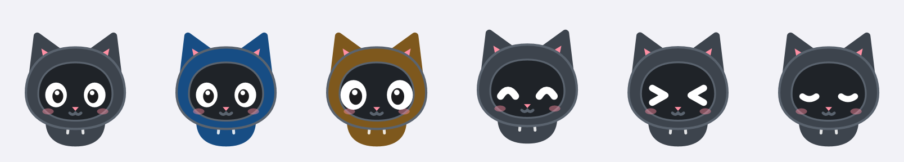 |
| **PatPat** — **Shift + clique** no mascote (na ilha ou na área de trabalho) e uma mãozinha em pixel art faz carinho na cabeça dele: 5 quadros em 300 ms, o mascote amassa, fecha os olhos feliz e solta coraçõezinhos. Segure para continuar o afago. Ideia do mod de Minecraft [PatPat](https://github.com/LopyMine/PatPat); o sprite é nosso. | 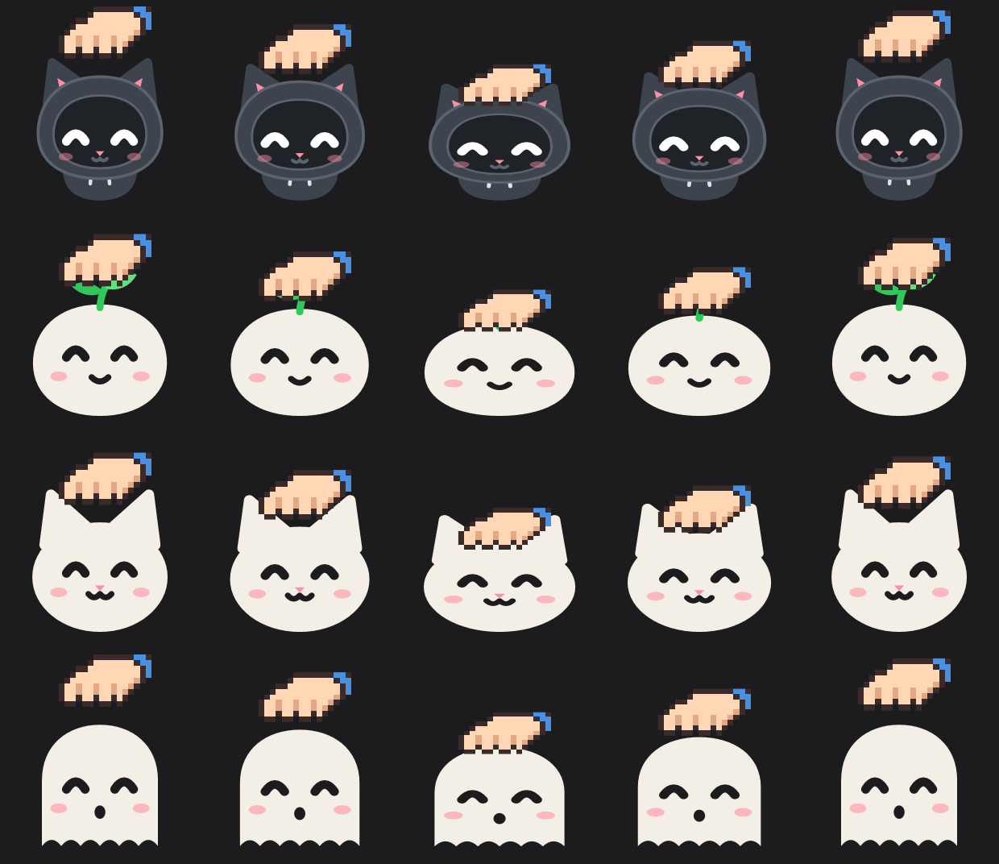 |
| **Permitir / Negar** — quando o Claude Code pede permissão (rodar um comando, editar um arquivo), a pergunta aparece na ilha como uma pílula discreta, sem abrir a ilha; passe o mouse ou clique nela para ver o comando e responder (dá para trocar por o painel aberto direto em *Configurações → Agentes*). Sem resposta em ~55 s, ele pergunta no terminal como sempre. | 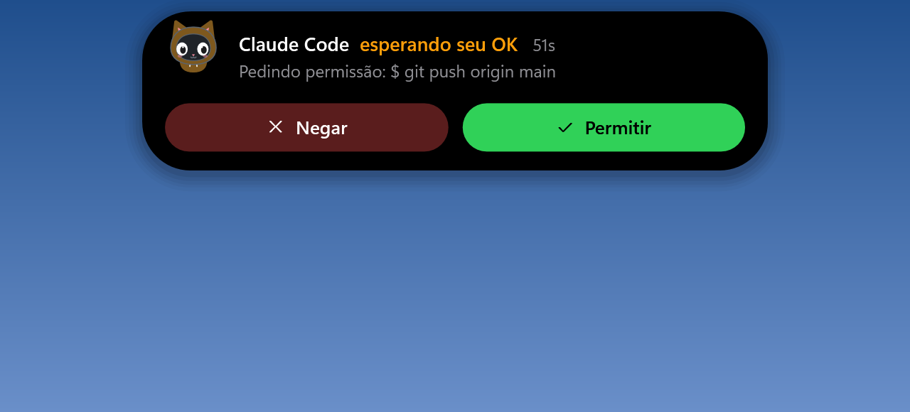 |
| **Roupinhas** — gorro, chapéu de festa, gorro de Natal, chapéu de palha, óculos escuros e coroa. No modo automático o mascote se veste sozinho no Natal, nas festas juninas e no Ano-Novo. O mascote também pode morar na **área de trabalho**: arraste para onde quiser; ele corre até a ilha quando um agente chama. |  |
| **Agentes ao vivo** — o mascote do agente, os passos (Leitura, Edição, Terminal…) e o diff da última edição; com vários agentes, a lista de todos com o mascote de cada um. | 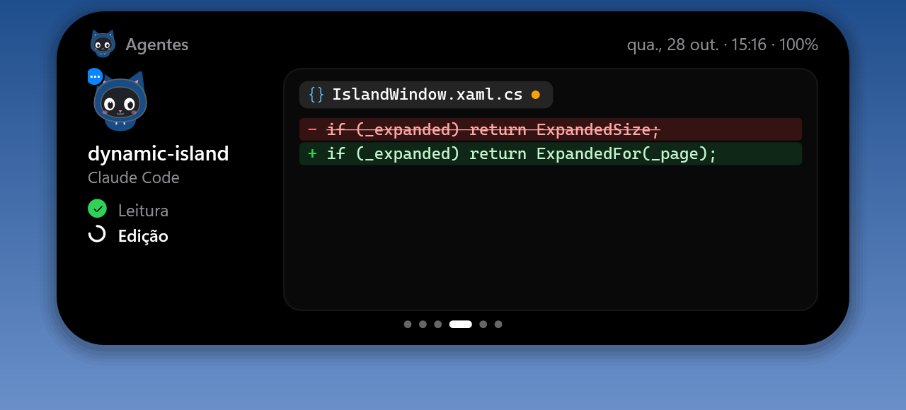 |
| **Vidro (desfocado)** — "liquid glass" estilo iOS 26: o fundo atrás da ilha é fosco no meio e se curva como uma lente nas bordas, com brilho na borda, além de 8 cores sólidas (Obsidiana, Grafite, Ardósia, Oceano, Floresta, Café, Ameixa, Cereja) e o tema claro **Porcelana**. | 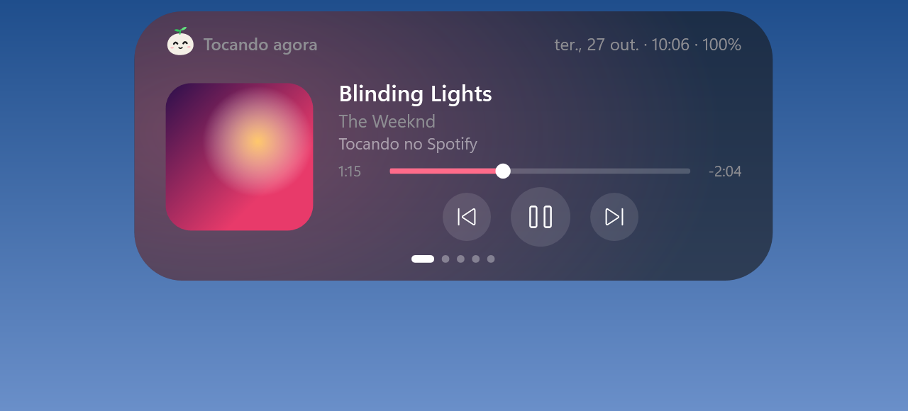 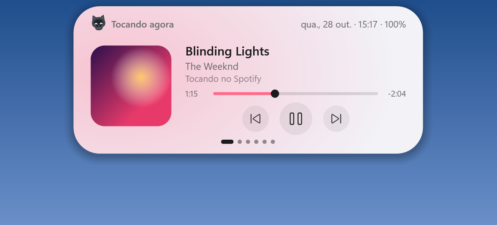 |
| **Mídia** — capa, título, progresso e controles de qualquer player (Spotify, YouTube…). A cor de destaque vem da capa. Com mais de um app tocando, bolinhas sobre a capa escolhem qual controlar. | 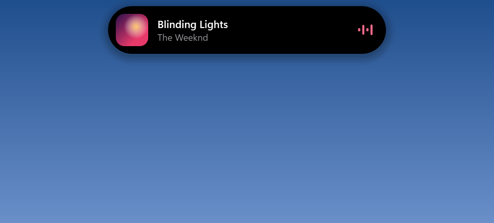 |
| **Letra sincronizada** — a linha que está sendo cantada aparece na ilha (letras do [LRCLIB](https://lrclib.net), guardadas no PC). Precisa de um player que informe a posição da música, como o app do Spotify. | 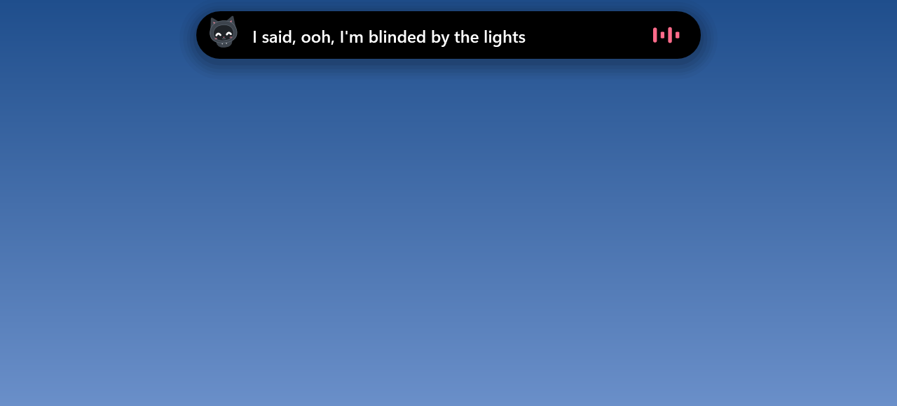 |
| **Volume** — barra ao mudar o volume (role o mouse sobre ela para ajustar). | 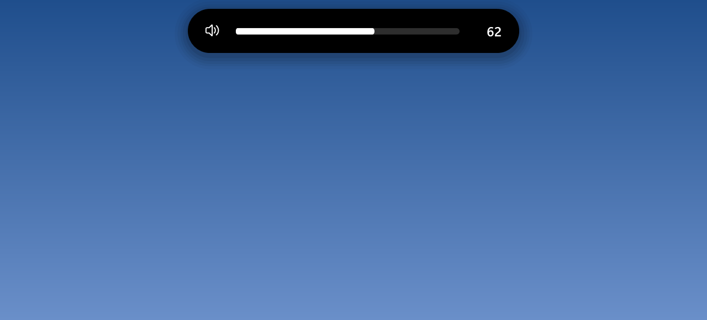 |
| **Agentes de IA** — azul trabalhando, laranja precisa de você, verde concluído. | 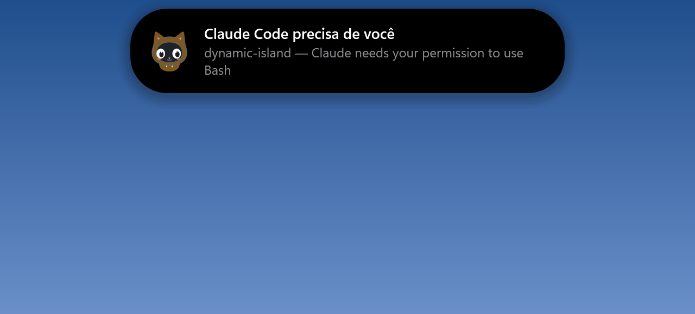 |
| **Jarvis** — o assistente [JARVIS](https://github.com/theuslpszbr15/JARVIS) dentro da ilha: toque **Ctrl+Alt+J** para escrever, segure para falar, ou diga "Ei Jarvis". A ilha abre na página dele, com o brilho de voz do QuickVoice (as cores sobem da borda seguindo a sua voz e a do Jarvis). Com a chave grátis da Groq ele executa tarefas (apps, sites, música, timer, lembretes, tarefas, Bloco de Notas, arquivos, ler a tela, scripts aprovados, plugins MCP e controle do computador com travas) e lembra das suas preferências. Sem chave, IA (Qwen 2.5 1.5B), voz (Piper) e microfone (whisper.cpp) rodam neste PC; baixe em *Configurações → Jarvis* (cada arquivo conferido por SHA-256). | 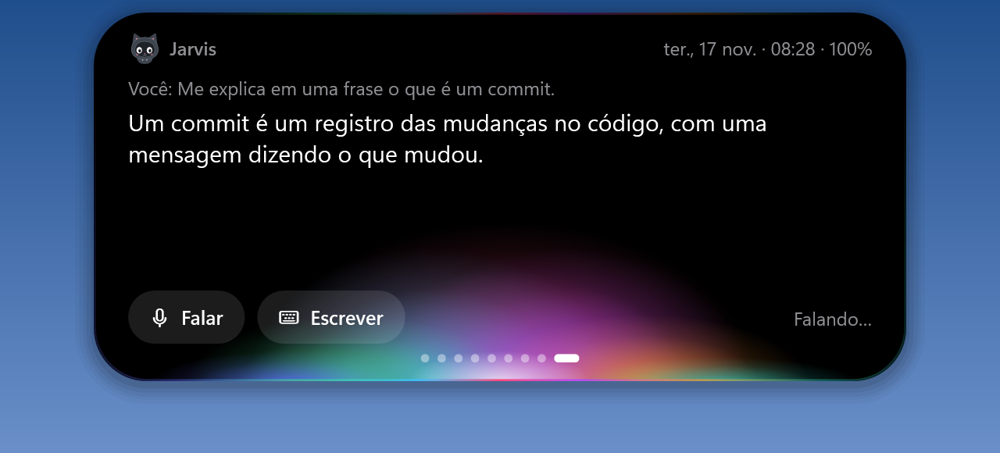 |
| **Sistema** — CPU, memória, disco, bateria, **brilho da tela** (arraste a barra) e bateria dos fones/mouses **Bluetooth** (avisa quando está acabando). | 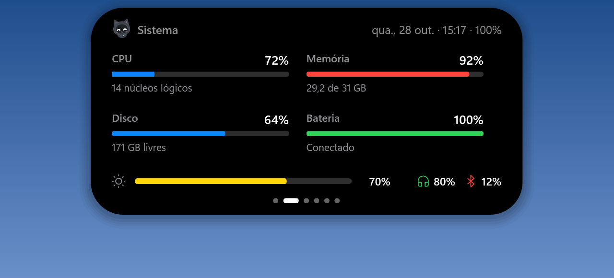 |
| **Agenda** — calendário do mês e o clima de agora na sua cidade (wttr.in). | 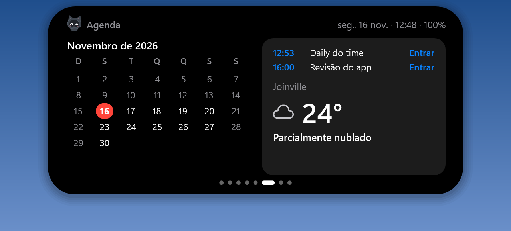 |
| **Reunião em 5 min** — com o link secreto iCal do Google Agenda ou do Outlook (ou o Outlook clássico aberto no PC), a ilha avisa 10, 5 e 1 minuto antes de cada reunião, com o botão **Entrar** (Teams, Meet, Zoom, Webex), e mostra as próximas na página Agenda. Reuniões que se repetem entram certinho. | |
| **Tarefas, água e foco** — tarefas com prazo, copos de água com lembrete, nota rápida e textos de 1 clique (PIX, e-mail). No **modo foco**, enquanto o timer corre, as notificações esperam e no fim a ilha mostra quanto você focou no dia e na semana. | |
| **Copiou, apareceu** — texto, imagem ou arquivos copiados aparecem por um instante; também Caps Lock e Num Lock. Gerenciadores de senha que pedem sigilo são ignorados. | 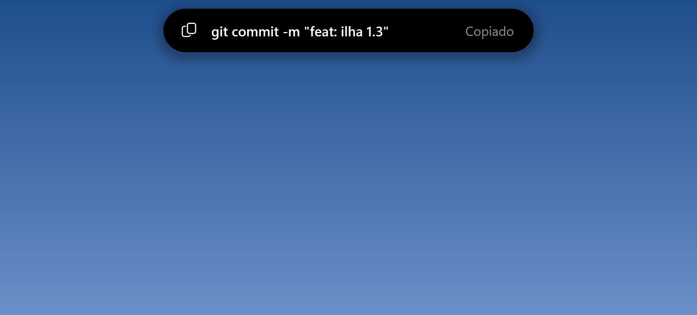 |
| **Resumo da semana** — toda segunda-feira: quanto tempo os agentes trabalharam, edições, comandos, projeto mais ativo. Dá para salvar como imagem. Os números ficam só no seu PC. | 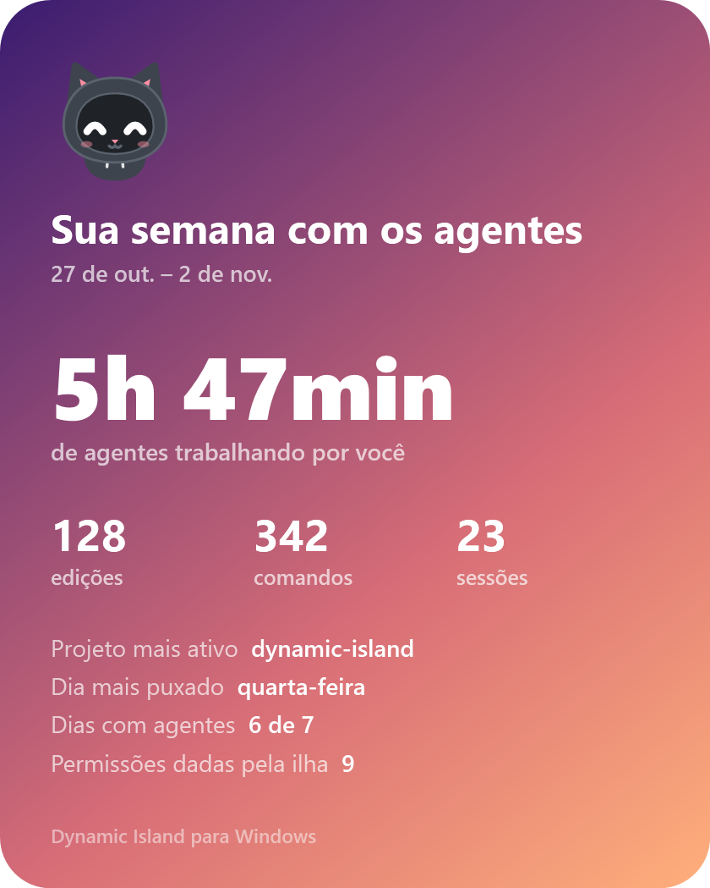 |
| **Bandeja de arquivos** — arraste arquivos até a ilha, arraste de volta quando precisar. | 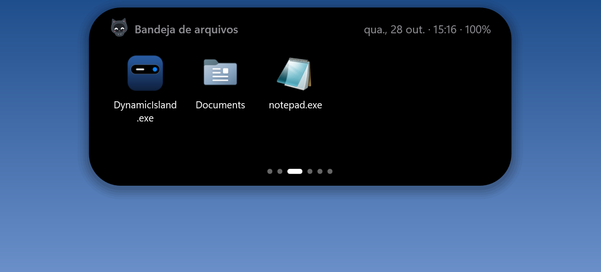 |
| **Timer / Pomodoro** — 5, 15, 25, 45 min ou 1 h; a contagem fica na ilha e ela toca um alarme no fim. | 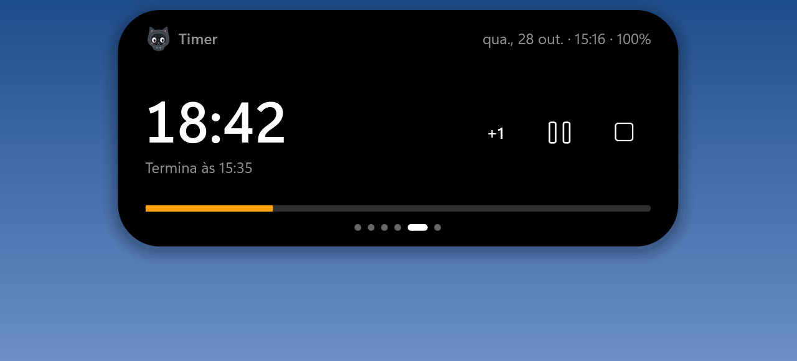 |
| **Notificações do Windows** — WhatsApp, Teams, Slack, e-mail… aparecem na ilha com o ícone do app. | 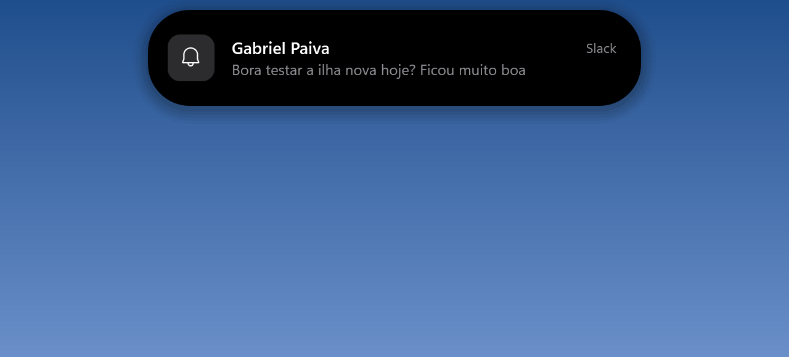 |
| **Quem entra na call do Discord** — a foto e o nome de quem entra na sua call (e uma pílula quando alguém sai). Sem configurar nada: a ilha lê a lista da call na janela do Discord (só enquanto você está numa call, e com o servidor da call aberto). Opcional: modo RPC pelo app da ilha ou um app seu, que mostra o @ (o Discord só libera para até 50 testers). | |
| **Microfone e câmera** — avisa qual app começou a usar e deixa um ponto laranja (mic) ou verde (câmera) ao lado. | 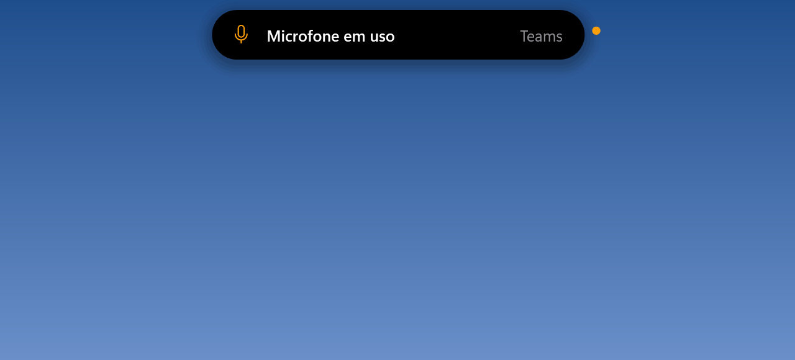 |
| **Formato notch** — colado na borda, com cantos invertidos. | 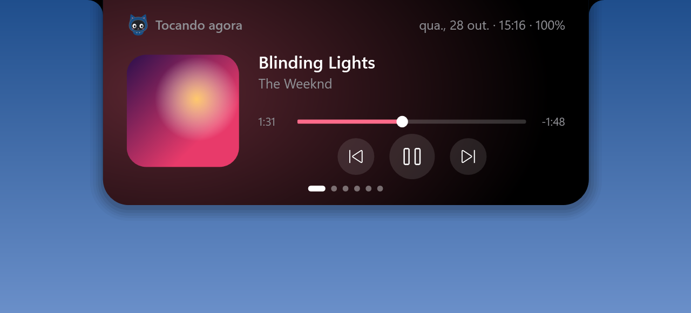 |

- **Discreta:** quando ociosa vira uma barrinha fina no topo; a janela é *click-through*, então abas do navegador continuam clicáveis.
- **Abre** parando o mouse sobre ela; a roda do mouse troca de página.
- **Vários monitores:** fica na tela principal, numa tela escolhida ou segue a janela ativa (respeita a escala de cada monitor).
- Some sozinha com app em tela cheia e não rouba o foco.
- **Atalhos:** `Ctrl+Alt+D` esconde/mostra a ilha, `Ctrl+Alt+M` mídia, `Ctrl+Alt+T` timer, `Ctrl+Alt+A` agentes, `Ctrl+Alt+C` agenda,
  `Ctrl+Alt+K` tarefas e foco, `Ctrl+Alt+J` Jarvis, `Ctrl+Alt+F` ditado, `Ctrl+Alt+L` tradução, `Ctrl+Alt+O` texto da tela (OCR).
  Dá para trocar as teclas em *Configurações → Geral*; se outro app já usa um atalho, a ilha avisa.
- **Esconder:** `Ctrl+Alt+D`, clique no ícone da bandeja ou *Esconder por 1 hora* no menu. Escondida, nada aparece (nem avisos).
- **Vídeos não incomodam:** YouTube, Netflix, Prime Video, Twitch… não abrem aviso nem deixam a pílula aberta (dá para ligar em *Mostrar na ilha → Vídeos*).
- **Atualizações:** avisa quando sai uma versão nova aqui no GitHub e se atualiza com um clique. O arquivo precisa bater com o
  SHA-256 da release (sem ele, a atualização é ignorada) e, se a ilha instalada for assinada, a nova versão precisa ter a mesma assinatura.

## Configurações

Clique direito na ilha (ou no ícone da bandeja) → **Configurações…**: um painel com tudo em um lugar — Geral
(esconder, formato, monitor, iniciar com o Windows, timer, atalhos), Aparência (tema, mascote, roupinha, mascote na
área de trabalho), Na ilha (notificações, letras, copiado, Caps Lock, vídeos, Discord), Agentes (Copilot, Claude Code, resumo da
semana), Celular (pareamento por QR), Bandeja de arquivos (fixar/remover itens) e Atualizações.

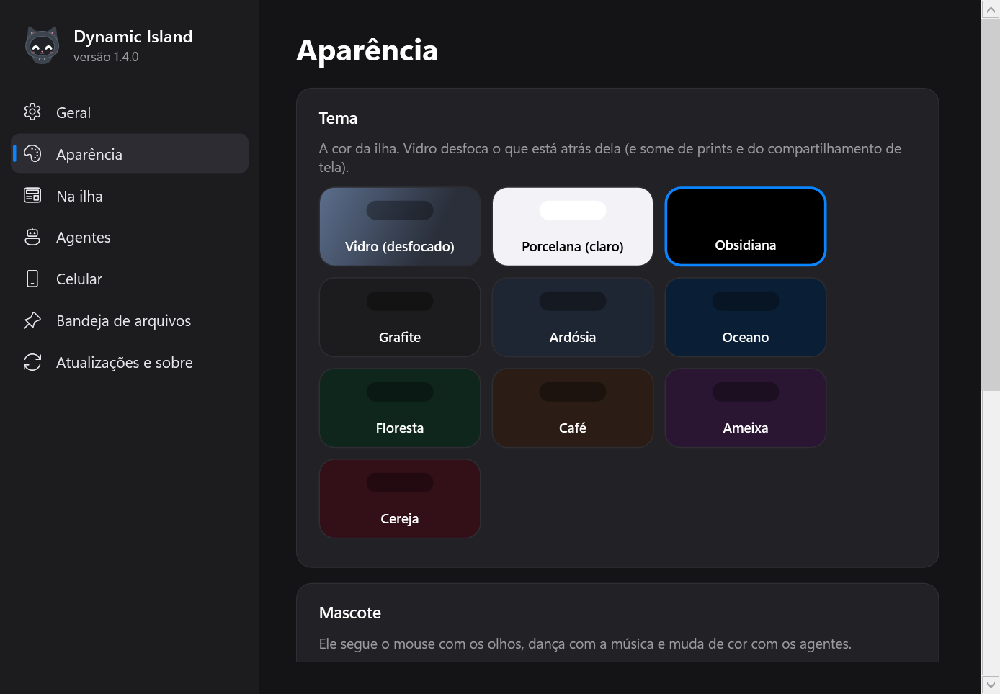

> No tema **Vidro** a ilha não aparece em prints nem em compartilhamento de tela: ela se esconde da captura
> para conseguir desfocar o que está atrás dela.

## Compilar

Requer Windows 10 (2004+) ou 11 e o .NET 10 SDK.

```powershell
dotnet build
.\bin\Debug\net10.0-windows10.0.22621.0\DynamicIsland.exe

# executável único (o mesmo da página de Releases)
dotnet publish -c Release -r win-x64 --self-contained -p:PublishSingleFile=true `
  -p:IncludeNativeLibrariesForSelfExtract=true -p:EnableCompressionInSingleFile=true -p:DebugType=none -o publish
```

`DynamicIsland.exe --install` instala sem perguntar; `--uninstall` remove (é o que *Configurações → Aplicativos* chama).

## Agentes de IA

Em **Configurações → Agentes → Conexões**, ligue o agente que você usa. A ilha escreve os hooks na configuração dele,
guarda antes uma cópia datada do arquivo (`.bak`), não mexe nos seus hooks e, ao desligar, tira só o que colocou.

| Agente | Arquivo | Na ilha |
|---|---|---|
| Claude Code | `~/.claude/settings.json` | passos, diff, Permitir / Negar (também no celular) |
| Codex CLI | `~/.codex/hooks.json` (no Codex, rode `/hooks` uma vez e confie) | passos, Permitir / Negar |
| Gemini CLI | `~/.gemini/settings.json` | passos e quando ele pede permissão (a resposta é no terminal) |
| Antigravity (`agy`) | `~/.gemini/config/hooks.json` | passos; com *Comandos do Antigravity na ilha*, Permitir / Negar nos comandos de terminal |
| OpenCode | `~/.config/opencode/plugins/dynamic-island.js` (reinicie o OpenCode) | passos, Permitir / Negar |
| Copilot (VS Code / CLI) | `~/.copilot/hooks/dynamic-island.json` | passos (vale para chats novos) |

Sem resposta na ilha (ou com a ilha fechada), cada agente pergunta no próprio terminal, como sempre: a ilha nunca
permite nada sozinha.

- **Claude Code à mão:** menu da bandeja → *Copiar hooks do Claude Code* e cole em `~/.claude/settings.json`.
- **Qualquer script:**

  ```powershell
  DynamicIsland.exe agent --name "Build" --state working --text "dotnet build"
  # estados: working | waiting | done | idle | end
  ```

Os eventos chegam por um *named pipe* restrito ao usuário atual. O comando sempre sai com código 0 e só escreve
no stdout para responder a um pedido de permissão que você aceitou ou negou na ilha.

Conexões de rede (todas opcionais): letras no `lrclib.net`, clima no `wttr.in` e a checagem de versão na API do GitHub.

## Aprovar pelo celular (Android)

O app **Dynamic Island para Android** (pasta [android/](android), Kotlin + Jetpack Compose, com o Bit) é um app
normal: liga o celular à ilha do PC, recebe os pedidos de permissão do Claude Code e mostra seus agentes. **Negar**
funciona direto na notificação; **Permitir** abre a digital ou o bloqueio de tela na hora, e o app avisa se a resposta chegou ao PC. O celular também avisa quando um agente termina ou fica esperando você, e volta a se ligar ao PC sozinho depois de reiniciar. A aba **Bandeja do PC** mostra o que
está fixado na bandeja de arquivos da ilha e abre o item no PC com um toque (também pede a digital).
Serve para qualquer Android 11+.

1. Baixe `DynamicIsland-Android.apk` da página de Releases no celular e instale (o Android pede para permitir
   instalações do navegador uma vez).
2. No PC: **Configurações → Celular → Ligação com o celular**. Aparece um QR code.
3. No app: **Escanear código do PC**. No mesmo Wi-Fi a ligação é direta; fora de casa ela passa pelo repasse (veja abaixo).

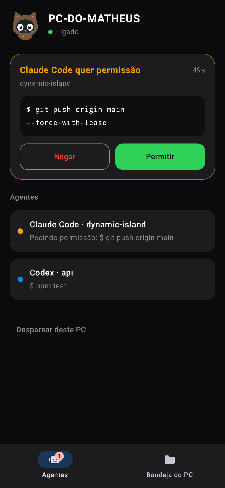 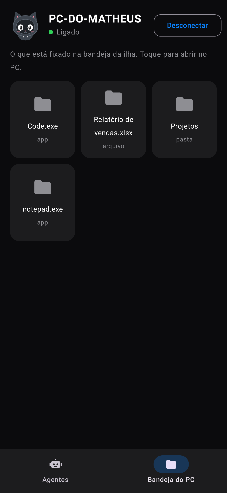

Como funciona: a ilha escuta só na rede local (porta 47900) e só enquanto a opção está ligada; o celular aceita
apenas o certificado do PC lido no QR (TLS com *pinning*) e manda o segredo do pareamento; a decisão vale só para o
pedido exato que ainda está esperando. Comandos com mais de 500 caracteres só podem ser negados pelo celular.
Redes de visitante/corporativas costumam isolar os aparelhos, e o Windows pode pedir para liberar a ilha no firewall.
Desenho do protocolo inspirado no [Coucou](https://github.com/Louis-CFM/coucou) (MIT); código e mascote são nossos.

Se o IP do PC mudar, o celular procura o PC pareado na rede (UDP 47900) e reconecta sozinho, sem parear de novo.

**Celular e PC juntos** (aba **PC** do app):
- **Área de transferência:** copiou no PC, já está no celular. Do celular para o PC vai quando você abre o app, pelo botão
  *Enviar copiado* ou pelo bloco rápido **Copiado → PC** (o Android só deixa ler o copiado com o app na frente).
- **Controle remoto:** tocar/pausar, próxima, anterior, volume e mudo; **bloquear o PC** e **desligar daqui a 15 min, 30 min,
  1 h ou 2 h** (esses dois pedem a digital; dá para cancelar o desligamento pelo celular ou pela ilha); abrir os apps e arquivos fixados.
- **Ligações na ilha:** quem está ligando aparece na ilha do PC, com o nome do contato (ligue no app; pede acesso ao
  telefone e aos contatos).
- **Ligar o PC:** com o PC desligado, o botão **Ligar o PC** (aba PC) manda o "pacote mágico" (Wake-on-LAN) para a
  placa de rede com cabo. Funciona com o celular no Wi-Fi de casa; de fora, só se o roteador repassar o pacote (porta UDP
  para o PC + DDNS). Precisa de Wake on LAN ligado na BIOS e na placa, e da inicialização rápida do Windows desligada:
  *Configurações → Celular → Ligar o PC pelo celular* confere e mostra o caminho.

**Fora de casa (repasse):** com o celular em outra rede (4G, trabalho), PC e celular se falam por um *repasse* na
Cloudflare que só vê bytes cifrados. A ilha já vem com um repasse público. Se ele falhar ("chave do relay inválida" no
celular) ou você quiser um sem limites, crie o seu em **Configurações → Celular → Fora de casa → Criar meu repasse**:
1. Clique em **Criar meu repasse**. Abre uma janela do PowerShell que baixa, instala e publica tudo.
2. Se faltar o [Node.js](https://nodejs.org/pt/download), ela abre a página: instale a versão LTS e clique de novo.
3. No navegador, entre na sua conta [Cloudflare](https://dash.cloudflare.com/sign-up) (é grátis) e clique em **Allow**.
4. Se perguntar sobre um subdomínio `workers.dev`, digite `y` e escolha um nome.
5. Quando aparecer **Pronto!**, volte às Configurações: a ilha passa a usar o seu repasse sozinha.
6. No celular, escaneie o código de pareamento de novo.

Detalhes técnicos e o jeito manual: [relay/README.md](relay/README.md).

**Arquivos, fotos, vídeos e textos entre o PC e o celular** (até 30 MB por arquivo, vídeo até 60 MB, até 20 de uma
vez, texto até 100 mil caracteres):
- PC → celular: a aba **Enviar e receber** das Configurações (ou menu da bandeja → **Enviar pro celular…**), no estilo do LocalSend, tem **Arquivo**,
  **Pasta**, **Texto** e **Colar**, e as listas **Recebidos** e **Enviados**. Também dá para arrastar arquivos ou um texto até
  a ilha e soltar no lado **Mandar pro celular**, ou usar o botão de celular num item da bandeja. O celular
  pergunta antes (Aceitar pede o celular desbloqueado). Fotos vão para a Galeria (`Pictures/Dynamic Island`), vídeos
  para `Movies/Dynamic Island`, o resto para `Downloads/Dynamic Island`; texto vai para a área de transferência.
- Celular → PC: no app, a aba **Enviar** tem **Arquivo**, **Foto/vídeo**, **Texto** e **Colar**, e a aba **Histórico**
  mostra o que foi recebido e enviado. De outros apps: **Compartilhar → Mandar pro PC**. A ilha pergunta antes (clique para aceitar) e salva
  em `Downloads\Dynamic Island`, marcado como vindo da internet (o Windows avisa antes de abrir um programa); texto
  vai para a área de transferência.

Os arquivos vão por uma conexão própria, com o mesmo TLS fixado e o mesmo segredo: direto no Wi-Fi de casa ou pelo
relay fora de casa, que continua vendo só bytes cifrados. Quem recebe confere tamanho e SHA-256 antes de guardar e
apaga o que vier pela metade; caminhos de pasta nunca saem do aparelho. Dá para desligar em **Configurações →
Celular → Arquivos e textos com o celular**.

Compilar: JDK 17+ e Android SDK 35, `cd android` e `gradlew assembleRelease`. Para publicar, assine com uma chave própria:
crie `android/keystore.properties` (`storeFile`, `storePassword`, `keyAlias`, `keyPassword`; fica fora do git) ou use as
variáveis `DI_STORE_FILE`, `DI_STORE_PASSWORD`, `DI_KEY_ALIAS` e `DI_KEY_PASSWORD`. Sem chave, o release usa a chave de debug
da máquina, e esse APK não atualiza por cima de um assinado em outro lugar.
Veja [android/ASSINATURA.md](android/ASSINATURA.md): backup da chave e aviso de que quem tem o APK debug precisa desinstalar uma vez.

## Desenvolvimento

`DynamicIsland.exe --snapshot <pasta>` renderiza todos os estados da ilha em PNG com dados de
demonstração (foi assim que as imagens acima foram geradas).

Testes: `dotnet test tests/DynamicIsland.Tests` (Windows) e `cd android && gradlew testReleaseUnitTest`. O GitHub Actions
roda os dois em cada push e pull request. Falhas ficam em `%APPDATA%\DynamicIsland\error.log`; as configurações são salvas
de forma atômica, com a versão anterior em `settings.json.bak`.

Para um fork: troque `UpdateRepository` em `DynamicIsland.csproj` (atualizações e links) e `Company` (nome em *Aplicativos*).

| Arquivo | Conteúdo |
|---|---|
| `IslandWindow.xaml(.cs)` | Interface, animação de mola, estados e páginas |
| `IslandWindow.Activities.cs` | Timer, notificações e indicador de microfone/câmera |
| `IslandWindow.Extras.cs` | Permissões, pílula de info (área de transferência, Caps Lock), atalhos, letras, players, brilho, Bluetooth, agenda |
| `DesktopPetWindow.cs`, `RecapWindow.cs` | Mascote na área de trabalho e resumo da semana |
| `Services/Updater.cs`, `LyricsService.cs`, `WeatherService.cs` | Atualização pelo GitHub, letras (LRCLIB) e clima (wttr.in) |
| `Services/Brightness.cs`, `BluetoothBattery.cs`, `AgentStats.cs` | Brilho (DDC/CI e WMI), bateria Bluetooth e estatísticas locais |
| `PetView.cs`, `IslandWindow.Pet.cs` | Mascotes (desenhados com formas WPF, humores e reações), temas, vidro e detalhe do agente |
| `Services/NotificationService.cs` | Notificações do Windows (UserNotificationListener) |
| `Services/DiscordWindow.cs`, `DiscordVoice.cs`, `IslandWindow.Discord.cs` | Quem entra e sai da call do Discord: lendo a janela (UI Automation) ou pelo RPC local (`discord-ipc`) |
| `Services/PrivacyMonitor.cs` | Apps usando microfone/câmera (mesmos dados do indicador do Windows) |
| `Services/Installer.cs` | Instalação por usuário, atalho e entrada em Aplicativos |
| `Services/MediaService.cs` | Sessão de mídia do Windows (GSMTC) |
| `Services/VolumeService.cs` | Volume via Core Audio |
| `Services/BatteryService.cs` | Eventos de energia |
| `Services/AgentHub.cs`, `AgentCli.cs` | Pipe dos agentes e CLI dos hooks |
| `Services/AtomicFile.cs`, `Log.cs` | Salvamento atômico (com .bak) e o `error.log` |
| `Hotkeys.cs` | Atalhos globais: ações, teclas padrão e formato salvo nas configurações |
